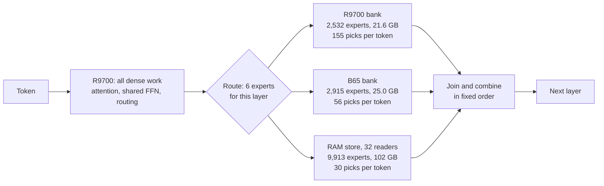

# crosslane

**A 763-billion-parameter DeepSeek on one desktop, at 25.6 tokens per second, with an AMD GPU, an Intel GPU and system RAM all computing every layer at the same time.**

| | |
|---|---|
| **Speed** | **25.57 tok/s** median (25.47 / 25.57 / 25.65), generating real code |
| **Against stock** | **2.59×** stock [Strata](https://github.com/Niko1221/Strata) on the same machine and the same model file (9.89 tok/s) |
| **How exact** | No speculation, no skipped experts, no changed routing. Every speed-up is proven byte-identical at a fixed placement |
| **Fastest working code** | **295 s**, for a module that passed its own 13 tests and independent checks (one answer) |
| **Hardware** | Radeon AI PRO R9700 32 GB, Arc Pro B65 32 GB, Ryzen 9 9950X3D, 128 GB DDR5 |
| **Goal** | 30 tok/s. **Not reached yet**; see [what's left](#whats-left) |

crosslane is a research fork of Strata (pinned at `ffa80d73`, v0.2.10). Neither GPU can hold this model alone, so all three devices do their share of each layer's experts concurrently.

> **Status: research code, tested on one machine.** The results come from these engine sources run under our private safety guards. The standalone build, pack and benchmark scripts have passed CPU tests but **haven't yet run end to end on GPUs**, and the benchmark doesn't enable every setting used for the best result yet. Expect to read code.

## How it works

The model is DeepSeek V4.1 Flash 1017: 40 layers, 384 routed experts per layer, 6 picked per token, so 240 expert computations for every token. We split them by what each device does best:

What made the difference, in the order we found it:

- **Three expert lanes per layer.** Each lane runs its picks at once, then they join in a fixed order, so the math doesn't depend on who finished first.
- **Measured placement.** A rebalancer uses real per-lane costs from a real run and moves experts so all three lanes finish together. It's the biggest single lever: +23% in one step at times.
- **New kernels for both vendors.** An exact-order structure-of-arrays dot-product kernel for IQ2_XXS, IQ2_XS and IQ1_M on the B65, per-layer expert batching on the R9700 (six experts in 227 µs instead of 649 µs).
- **Dense on the faster card only**, with a queued schedule, so no activations cross between GPUs inside a layer.
- **Parallel Engram reads.** DeepSeek's memory lookup hits 24 rows per layer on disk. Eight queued reads with read-ahead took it from a noisy 5–17 ms per token to under 2 ms.
- **Starting expert work early.** CPU and B65 start before the shared FFN drains, instead of after it. With a faster AVX2 combine, that cut about 6 ms per token.

## Results

Realistic task: one 325-token prompt asking for a complete Python module with tests. Sampled (T=1, top-k 64), warm engine, one warm-up then 3 measured answers, 8,192-token cap, same model file throughout. Full history, spreads and raw hashes are in [docs/RESULTS.md](docs/RESULTS.md).

| Step | Change | tok/s | Strict |
|---|---|---:|---:|
| Stock | Strata, R9700 + RAM only | 9.89 | — |
| a3 | First fork run, both GPUs + RAM store | 10.28 | 1/3 |
| a5 | Subgroup B65 attention | 12.22 | 1/3 |
| a6r | IQ2_XS B65 kernels + rebalance | 12.96 | 2/3 |
| a8c | All dense on the R9700, packed B65 kernel | 14.41 | 1/3 |
| a8r2 | Two rebalance rounds | 15.85 | 0/3 |
| a11 | Queued R9700 schedule + rebalance | 17.04 | 0/3 |
| a13r | Exact-order B65 SoA kernel + rebalance | 18.04 | 0/3 |
| a14r | R9700 expert batching + rebalance | 21.27 | 2/3 |
| a15r | Parallel Engram reads + rebalance | 22.57 | 0/3 |
| **a16r** | **Faster combine, early expert start + rebalance** | **25.57** | **0/3** |

### Where a token goes now

39.1 ms per token in the best run:

| Part | ms | |
|---|---:|---|
| Dense, excluding Engram layers | 22.15 | Matrix-vector products are over half; large ones already run at 380–618 GB/s of weights against a measured 612 GB/s stream |
| Engram-containing regions | 1.74 | Includes those layers' other work |
| Expert join | 11.91 | CPU 8.7, B65 9.6, R9700 8.2 ms of overlapping service |
| Everything else | 3.32 | Mostly head and timer boundaries; real host overhead is about 0.9 ms |

### The strict score, honestly

**All three answers in the best run hit the 8,192-token cap before finishing, so it scored 0/3.** The model reasons for a long time first, and these answers were cut off, not looping. Across our history 43 of 72 comparable answers hit that cap, so three in a row is plausible by chance. That neither shows nor rules out a quality loss.

With room up to 11,900 tokens at the same setup, the one measured answer finished on its own at 25.59 tok/s and passed strict with working code in 295 s. One answer proves little, so a 10-answer test decides this and isn't done yet.

Moving experts between devices also changes the numbers slightly, even with exact kernels (top-1 96.6%, mean KL 0.014), most likely because CPU and GPU lanes quantize activations differently. So "exact" here means byte-identical logits at a fixed placement, checked over 581 teacher-forced positions for every kernel and schedule. Different placements are different runs of a very close model, not the same bytes.

### Also measured

- **Long prompts:** an 8,192-token prefill took 369 s at 22.2 tok/s on an earlier setup, with no slowdown by position. It's token by token today, so it's the weak spot.
- **Long context:** a 12,001-position run peaked at 28.5 GB on the R9700 and 25.3 GB on the B65, flat with position.
- **Memory:** 21.6 GB and 25.0 GB of expert banks, plus 102 GB preloaded in RAM. Experts never come from disk during decode.

## What's left

30 tok/s needs 33.3 ms per token, 5.8 ms less than today.

- **Exact kernels:** our estimate is a plateau around 26–28 tok/s. The remaining levers are small and overlap, and no credible exact route to 30 has shown up yet. Being wrong would be welcome.
- **DeepSeek's DSpark drafter:** a 1.5× gain would justify building a verify path. So far: checking several rows at once stays byte-identical, and three rows cost 0.34–0.52 of three separate runs on the big matrices. Acceptance on this model and the whole cycle are unmeasured.
- **Re-encoding experts to Q2_K: measured, rejected.** Experts grow 50%, about 1,430 fall back to the CPU, and the projection is 3.2 ms slower per token.
- **Quality:** the 10-answer test, and whether a lower reasoning effort reaches working code sooner.
- **Prefill:** batching it, estimated at 38–72 tok/s on exact paths.

The dead ends are as useful as the wins, so they're in [docs/DEAD_ENDS.md](docs/DEAD_ENDS.md).

## The model

[`AtomicChat/DeepSeek-V4.1-Flash-1017-Uncensored-GSQ-RCO-GGUF`](https://huggingface.co/AtomicChat/DeepSeek-V4.1-Flash-1017-Uncensored-GSQ-RCO-GGUF), rung IQ2_XXS: 138 GB of backbone plus a 110 GB Engram table. It's [ISTA-DASLab's GSQ-RCO](https://huggingface.co/ISTA-DASLab/DeepSeek-V4.1-Flash-1017-GSQ-RCO-GGUF) quantization of DeepSeek's weights, where GSQ learns the low-bit rounding and RCO picks each tensor's type, with AtomicChat's one-direction refusal edit on 82 dense tensors. crosslane changes how the file runs, not what's in it. Weights aren't included here.

The kernels cover IQ2_XXS, IQ2_XS and IQ1_M. The engine is DeepSeek-specific today; the placement and three-lane ideas aren't.

## How this was built

Built by **Marty** with two AI coding agents working as a pair: **Claude** (Anthropic) and **Codex** (OpenAI). Each one reviewed the other's designs and code before anything ran on the hardware, and each caught real mistakes in the other's work. The agents wrote most of the code. Marty set the goals ("both GPUs fully involved", "no stock runs", "30 tok/s on this hardware"), made the calls on trade-offs and refused the easy answers.

The rules that kept it honest: raw data for every run, at least 3 repetitions with spread reported, the same model file, stop rules written before a run, and failures logged the same day.

## Try it

See [docs/BUILD.md](docs/BUILD.md): `tools/build.sh`, `tools/pack.py`, `tools/bench.sh`. You need ROCm (HIP) for the AMD card, oneAPI 2026.1 (SYCL/ESIMD) for the Intel card and the upstream Strata source at the pinned commit. The quick benchmark uses a default placement and won't reproduce the numbers above; they use measured placement (`engine/strata/warm/make_costs.py` + `rebalance.py`).

## Help wanted

[CONTRIBUTING.md](CONTRIBUTING.md#where-to-help) ranks what would help most: R9700 matrix-vector kernels, co-selection-aware placement, batched prefill, and other GPU pairs. Two AMD cards, AMD + NVIDIA and Intel + NVIDIA are all untested and very welcome.

## Licence

MIT. Upstream Strata and Project Maya (MIT) and ggml/llama.cpp (MIT) notices are kept in
[licenses/](licenses/) and `engine/strata/sycl/moe/licenses/`. Intel dpct helper headers keep their Apache-2.0 WITH LLVM-exception headers.
