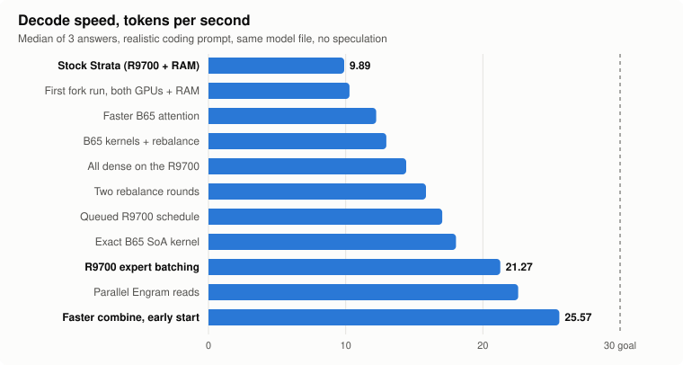
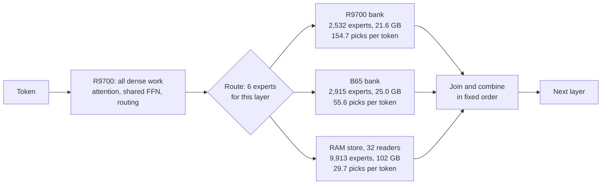

# crosslane

**A 763-billion-parameter DeepSeek on one desktop, at 25.6 tokens per second, with an AMD GPU, an Intel GPU and system RAM computing each layer's experts concurrently.**

| | |
|---|---|
| **Speed** | **26.27 tok/s** median over ten answers (25.93–26.42), generating real code. 25.57 tok/s with the code in this repo today |
| **Against stock** | **2.66×** our recorded stock [Strata](https://github.com/Niko1221/Strata) run on the same machine and model file (9.89 tok/s, one GPU, 16 readers, a 51 GB store). A whole-system comparison, not a kernel A/B |
| **How exact** | No speculation, no skipped experts, routing algorithm unchanged. Tested kernel and schedule modes are byte-identical at a fixed placement over 581 teacher-forced positions; placement changes alter results slightly (see below) |
| **Does it write working code?** | **6 of 10 answers passed strict** with room up to 11,900 tokens, working code in 292–439 s. Includes prefill, excludes engine load |
| **Hardware** | Radeon AI PRO R9700 32 GB, Arc Pro B65 32 GB, Ryzen 9 9950X3D, 128 GB DDR5 |
| **Goal** | 30 tok/s. **Not reached yet**; see [what's left](#whats-left) |

**Why this exists:** GPUs are painfully expensive right now, and a lot of us run whatever we could get, often a mix nobody optimises for. This is one person's attempt to get the most out of the hardware they already have, shared so others can use it or share what worked on theirs. Different GPUs, different models and failures are all welcome. On other GPUs, measure expert service, residency and join time before choosing placement; these gains depend on that balance.

crosslane is a research fork of Strata (pinned at `ffa80d73`, v0.2.10). Neither GPU can hold this model alone, so the active lanes compute that layer's routed experts concurrently, and dense work stays on the R9700.

> **If you run ROCm 7.1 and memory keeps growing, try 7.2.1.** On Fedora's `rocm-hip-7.1.1-3.fc44`, our fork's anonymous memory grew about 270 KB per generated token, and the run hit its guard after 59 minutes. Stock Strata also showed memory growth, at a different rate. Allocation stacks pointed at ROCm's profiling signals and timestamps. Running the same binaries on AMD's ROCm 7.2.1 libraries from a private folder, no install and no driver change, gave byte-identical output over 581 teacher-forced positions and flat memory across ten answers. See [the steps](docs/BUILD.md#rocm-721-without-installing-it).
>
> **Status: research code, tested on one machine.** The public sources are a16 (25.57 tok/s), run under our private safety guards. The a17 sources behind 26.27 tok/s and the 6-of-10 quality result aren't exported yet. The standalone build, pack and benchmark scripts have passed CPU tests but **haven't yet run end to end on GPUs**. Expect to read code.

## How it works

The model is DeepSeek V4.1 Flash 1017: 40 layers, 384 routed experts per layer, 6 picked per token, so 240 expert computations for every token. We split them by what each device does best:

Every device is doing real work, in a different role:

| | R9700 | Arc Pro B65 | CPU + RAM |
|---|---:|---:|---:|
| Dense work (attention, shared FFN, routing) | all of it, 22 ms | none | none |
| Expert bank | 2,532 experts, 21.6 GB | **2,915 experts, 25.0 GB, the largest GPU bank** | 9,913 experts, 102 GB |
| Mean expert picks per token, of 240 | 154.7 | 55.6 | 29.7 |
| Time per pick | 0.05 ms | 0.17 ms | 0.29 ms |
| Expert work per token | 8.2 ms | **9.6 ms, the longest lane** | 8.7 ms |

The R9700 is faster per pick, so the rebalancer gives it the most-used experts, and the B65 and CPU lanes get fewer picks. That brings the lanes' total service close, though individual layers still differ. The B65 runs no dense work: its 9.6 ms of expert service is out of a 39.1 ms token (service time, not a GPU-utilisation measurement). It did in earlier versions, but dense layer 0 took 11.5 ms there against 0.48 ms on the R9700, and moving all dense over, together with a packed-strip B65 kernel, took us from 12.96 to 14.41 tok/s. That's the part of "both GPUs equally involved" we haven't reached.

What made the difference, in the order we found it:

- **Three expert lanes per layer.** Each lane runs its picks at once, then they join in a fixed order, so the math doesn't depend on who finished first.
- **Measured placement.** A rebalancer uses real per-lane costs from a real run and moves experts to bring the lanes' total time together. Rebalancing took 20.69 to 25.57 tok/s in the last step; placement also changes the answers, so that's an unpaired comparison of medians.
- **New kernels for both vendors.** An exact-order structure-of-arrays dot-product kernel for IQ2_XXS, IQ2_XS and IQ1_M on the B65, per-layer expert batching on the R9700 (six experts in 227 µs instead of 649 µs).
- **Dense on the faster card only**, with a queued schedule, so there's no dense-stage hand-off between GPUs. Expert inputs and outputs still transfer.
- **Parallel Engram reads.** DeepSeek's memory lookup hits 24 rows per layer on disk. Parallel reads, read-ahead and a 128 MiB row cache cut a noisy 5–17 ms per token; the whole Engram-containing regions now total 1.74 ms, including other work in those layers.
- **Starting expert work early.** CPU and B65 start before the shared FFN drains, instead of after it. Together with a faster AVX2 combine, that cut 5.8 ms per token on token-identical answers. We only measured the two together.

## Results

Realistic task: one 325-token prompt asking for a complete Python module with tests. Sampled (T=1, top-k 64), warm engine, one warm-up then 3 measured answers, 8,192-token cap, same model file throughout. Full history and spreads are in [docs/RESULTS.md](docs/RESULTS.md). The answers from the best setup are in [docs/evidence/](docs/evidence/). The guarded-run logs behind the numbers stay private for now, because they're full of host details.

| Step | Change | tok/s | Strict |
|---|---|---:|---:|
| Stock | Strata, R9700 + RAM only | 9.89 | — |
| a3 | First fork run, both GPUs + RAM store | 10.28 | 1/3 |
| a5 | Subgroup B65 attention | 12.22 | 1/3 |
| a6r | IQ2_XS B65 kernels + rebalance | 12.96 | 2/3 |
| a8c | All dense on the R9700, packed B65 kernel | 14.41 | 1/3 |
| a8r2 | Two rebalance rounds | 15.85 | 0/3 |
| a11 | Queued R9700 schedule + rebalance | 17.04 | 0/3 |
| a13r | Exact-order B65 SoA kernel + rebalance | 18.04 | 0/3 |
| a14r | R9700 expert batching + rebalance | 21.27 | 2/3 |
| a15r | Parallel Engram reads + rebalance | 22.57 | 0/3 |
| a16r | Faster combine, early expert start + rebalance | 25.57 | 0/3 |
| a17 + VRAM | Batched SwiGLU, small kernel fusion, Engram priority, 512 MiB less GPU reserve + rebalance | 26.00 | 1/3 |
| **a17 + VRAM, ROCm 7.2.1** | **Same setup on the newer runtime, ten answers at 11,900 tokens** | **26.27** | **6/10** |

### Where a token goes now

39.1 ms per token on a16r (a17 + VRAM brings dense excluding Engram regions down to about 21.1 ms):

| Part | ms | |
|---|---:|---|
| Dense, excluding Engram layers | 22.15 | Matrix-vector products are over half; large ones already run at 380–618 GB/s of weights against a measured 612 GB/s stream |
| Engram-containing regions | 1.74 | Includes those layers' other work |
| Expert join | 11.91 | CPU 8.7, B65 9.6, R9700 8.2 ms of overlapping service |
| Residual | 3.32 | Wall minus the regions above, not an exclusive breakdown. A separate timed diagnostic found 0.95 ms of small host and copy steps outside dense, join, shared-FFN wait and head |

### Does it write working code?

**6 of 10 answers passed strict with room up to 11,900 tokens** (a17 + VRAM setup on ROCm 7.2.1, median 26.27 tok/s, working code in 292–439 s). At the old 8,192 cap only 3 of the same 10 would have passed, so the cap was hiding working answers. Ten answers on one task is still a rough number (about 31–83%), and there's no stock comparison yet, so it can't show whether we've lost quality. Of the four misses, three finished with code that failed the checks and one hit the cap while still going.

The a16r row:

All three a16r answers hit the 8,192-token cap before finishing, so it scored 0/3. The model reasons for a long time first, and these answers were cut off, not looping. Across our history 43 of 72 comparable answers hit that cap (a descriptive count with repeated streams, not independent trials), so three in a row isn't surprising. That neither shows nor rules out a quality loss.

Moving experts between devices also changes the numbers slightly, even with exact kernels (top-1 96.6%, mean KL 0.014), most likely because CPU and GPU lanes quantize activations differently. Routes change too (6,295 of 23,240 layer selections differ). So "exact" here means byte-identical logits at a fixed placement, checked over 581 teacher-forced positions for the tested kernel and schedule modes. Different placements are different runs of a very close model, not the same bytes.

### Also measured

- **Long prompts:** an 8,192-token prefill took 369 s at 22.2 tok/s on the a15r setup, with no slowdown by position. It's one diagnostic stream, token by token, and the weak spot.
- **Long context:** a 12,001-position run reached 28.5 GB on the R9700 (whole device) and 25.3 GB on the B65, flat with position. Sampling can miss spikes.
- **Memory:** 21.6 GB and 25.0 GB of expert banks, plus 102 GB preloaded in RAM. Experts never come from disk during decode.

## What's left

30 tok/s needs 33.3 ms per token, about 4.7 ms less than today.

- **Exact kernels:** our estimate is a plateau around 26–28 tok/s. The remaining levers are small and overlap, and no credible exact route to 30 has shown up yet. Being wrong would be welcome.
- **DeepSeek's DSpark drafter: parked.** We measured multi-row kernel costs on real captured rows and projected whole-token speed. At 4 draft rows that's 1.52× at best but 1.11× central, against the 1.5× we wanted. The R9700's dense kernels batch very well; expert join and the drafter evicting experts are what hurts, and the B65 and CPU have no multi-row expert kernels yet. No verifier was built.
- **Re-encoding experts to Q2_K: rejected.** Measured kernels plus a capacity model project 3.18 ms slower per token, with 1,434 experts pushed to the CPU. There was no full-model Q2_K run.
- **Reasoning effort:** whether a lower setting reaches working code sooner.
- **Engram read bursts:** layer 1 sometimes waits on disk with the GPU idle, costing up to 0.87 ms per token in one long run. Doubling the read queue depth to 16 didn't help (25.90 against 26.00 tok/s, same placement and text).
- **Prefill:** batching it, estimated at about 41 tok/s on exact paths against 22 today, in progress.
- **Giving the B65 more to do:** moving the shared FFN there as implemented is about 35× slower on layer 1 (1,510 µs against 43 µs), partly because that path still decodes with a scalar loop. The corrected capacity-constrained model projects no central gain; an optimistic unmeasured kernel projects about 1 ms per token, so we stopped there. Better ideas very welcome.

The dead ends are as useful as the wins, so they're in [docs/DEAD_ENDS.md](docs/DEAD_ENDS.md).

## The model

[`AtomicChat/DeepSeek-V4.1-Flash-1017-Uncensored-GSQ-RCO-GGUF`](https://huggingface.co/AtomicChat/DeepSeek-V4.1-Flash-1017-Uncensored-GSQ-RCO-GGUF), rung IQ2_XXS: 138 GB of backbone plus a 110 GB Engram table. It's [ISTA-DASLab's GSQ-RCO](https://huggingface.co/ISTA-DASLab/DeepSeek-V4.1-Flash-1017-GSQ-RCO-GGUF) quantization of DeepSeek's weights, where GSQ learns the low-bit rounding and RCO picks each tensor's type, with AtomicChat's one-direction refusal edit on 82 dense tensors. crosslane changes how the file runs, not what's in it. Weights aren't included here.

The kernels cover IQ2_XXS, IQ2_XS and IQ1_M. The engine is DeepSeek-specific today; the placement and three-lane ideas aren't.

## How this was built

Built by **Marty** with two AI coding agents working as a pair: **Claude** (Anthropic) and **Codex** (OpenAI). Each one reviewed the other's designs and code before anything ran on the hardware, and each caught real mistakes in the other's work. The agents wrote most of the code. Marty set the goals ("both GPUs fully involved", "no stock runs", "30 tok/s on this hardware"), made the calls on trade-offs and refused the easy answers.

The rules that kept it honest: raw data for every run, at least 3 repetitions with spread reported, the same model file, stop rules written before a run, and failures logged the same day.

## Try it

See [docs/BUILD.md](docs/BUILD.md): `tools/build.sh`, `tools/pack.py`, `tools/bench.sh`. You need ROCm (HIP) for the AMD card, oneAPI 2026.1 (SYCL/ESIMD) for the Intel card and the upstream Strata source at the pinned commit. `tools/bench.sh --preset a16` selects the frozen a16r settings and measured placement for this exact model and hardware (not yet run on GPUs from this repo); the default preset is a plain baseline and won't reproduce the numbers above. To measure your own placement, see `engine/strata/warm/make_costs.py` + `rebalance.py`.

## Help wanted

**Your own experience is the most useful thing you can share**, whatever your hardware: numbers, tweaks and what didn't work, even from a different model or tool. Open an issue or discussion. [CONTRIBUTING.md](CONTRIBUTING.md#where-to-help) ranks what would help most: R9700 matrix-vector kernels, co-selection-aware placement, batched prefill, and other GPU pairs. Two AMD cards, AMD + NVIDIA and Intel + NVIDIA are all untested and very welcome.

## Licence

MIT. Upstream Strata and Project Maya (MIT) and ggml/llama.cpp (MIT) notices are kept in
[licenses/](licenses/) and `engine/strata/sycl/moe/licenses/`. Intel dpct helper headers keep their Apache-2.0 WITH LLVM-exception headers.
